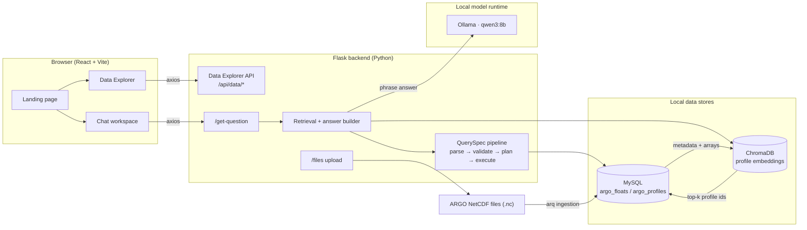

# IntelliQuery

An interactive web platform for exploring **ARGO** oceanographic data. IntelliQuery
ingests ARGO NetCDF profile files into MySQL, exposes the dataset through a
paginated Data Explorer and a natural-language query assistant, and uses a local
quantised language model (Qwen3 8B via Ollama) only to *phrase* answers whose
numbers are produced by deterministic Python/SQL code.

This repository is a college mini-project. It is a data-retrieval and
exploration tool, not a research-grade analysis package.

---

## Table of contents

- [Project overview](#project-overview)
- [Features](#features)
- [Architecture](#architecture)
- [Technology stack](#technology-stack)
- [Project structure](#project-structure)
- [Prerequisites](#prerequisites)
- [Installation and setup](#installation-and-setup)
- [Configuration](#configuration)
- [Usage](#usage)
- [Chatbot capabilities and limitations](#chatbot-capabilities-and-limitations)
- [Troubleshooting](#troubleshooting)
- [Academic project disclaimer](#academic-project-disclaimer)

---

## Project overview

ARGO is a global network of autonomous profiling floats. Each float periodically
descends to roughly 2,000 dbar and rises while measuring pressure, temperature and
salinity, producing a *profile* of the water column at a known time and place.

The official ARGO data distribution is a very large archive of NetCDF files. This
project addresses the practical question a student or analyst faces: **how do you
get from that archive to an explorable, queryable view of the data without
writing SQL by hand?**

IntelliQuery answers that by:

1. reading ARGO NetCDF profiles and normalising them into a relational schema,
2. presenting the dataset through tables, filters and per-profile charts,
3. accepting English questions and translating the ones it can answer exactly
   into validated, parameterised database queries,
4. stating plainly when a question is outside what the system supports.

---

## Features

### Implemented

**Data ingestion**
- NetCDF (`.nc`) profile ingestion with metadata extraction (WMO number, project,
  platform type, cycle, time, latitude, longitude, pressure/temperature/salinity
  arrays), stored as index-aligned JSON arrays.
- Idempotent re-ingestion: an existing `(float_id, cycle_number)` profile is
  skipped rather than duplicated.
- Provenance recorded per profile: source file name, SHA-256 of the file, and the
  profile index inside the file.
- Batch ingestion from a local corpus (`backend/main.py`) and single/multi-file
  upload through the backend (`POST /files`).
- QC, adjusted-value and BGC columns are present in the schema and populated where
  the source file provides them (see [Limitations](#chatbot-capabilities-and-limitations)).

**Data Explorer** (`/data`)
- Dataset overview cards: float count, profile count, date range, geographic extents.
- Paginated, sortable floats table with search by WMO number.
- Paginated, sortable profiles table with filters for WMO, profile ID, cycle,
  date range and latitude/longitude bounding box.
- Profile detail drawer: metadata, level-by-level measurement table, and
  temperature vs pressure, salinity vs pressure and pressure vs level charts,
  plus an optional standard-range overlay that highlights (never removes) points
  outside typical oceanographic ranges.
- CSV/JSON export of filtered profiles or measurements (`GET /api/data/export`).

**Chatbot** (`/chat`)
- Natural-language questions answered from the database.
- Deterministic structured-query pipeline: the question is parsed into a typed
  `QuerySpec`, validated, planned and executed with parameterised SQL. Queries it
  cannot represent safely are refused rather than approximated.
- Exact relational routes for WMO lookups, profile counts per float, float
  enumeration and one fixed regional annual-mean summary.
- Semantic discovery over ChromaDB embeddings when a question is conceptual
  ("find profiles with unusually warm surface water"), with the authoritative
  rows then read from MySQL.
- Conversational follow-ups ("How many are there?", "What about 2024?",
  "Only delayed mode") that reuse the previous structured filters.
- Explicit refusal for analyses that are not implemented (trend, seasonal,
  anomaly, correlation, dataset-wide statistics) instead of answering from a
  small retrieved sample.

**Frontend**
- React single-page app with a landing page, chat workspace and Data Explorer.
- Light/dark theme toggle.
- Configurable backend URL via `VITE_API_BASE_URL`.

### Illustrative (not database-derived)

On the chat page, the right-hand panel contains a temperature-anomaly line chart
and a 3D globe. Both are **static demonstration graphics with hard-coded values**
and are labelled "Illustrative · demo data" in the interface. They are not
computed from the ARGO database and must not be read as scientific findings.
Database-derived numbers are shown in the Data Explorer and in chatbot answers.

### Not implemented

- No user accounts, authentication or per-user data.
- No BGC (oxygen, chlorophyll, nitrate, pH) ingestion or charting.
- No geographic map view in the UI (a map-points API exists; the frontend shows a
  table-based explorer and the illustrative globe instead).
- No scheduled ingestion or job queue: ingestion is run manually.

---

## Architecture



**Request flow for a question**

1. `POST /get-question` receives `{ prompt, context }`.
2. A rule-based router classifies the question (general conversation, exact
   MySQL route, structured query, or semantic discovery).
3. For structured questions, `query_parser` → `validate_spec` → `query_planner`
   → `query_pipeline` produce parameterised SQL; Python computes the numbers.
4. For conceptual questions, ChromaDB returns the closest profile documents and
   the corresponding rows are fetched from MySQL.
5. Qwen3 8B (Ollama) turns the compact factual context into prose. The model is
   never the source of truth for a measurement.
6. Unsupported or ambiguous questions return an explicit clarification or refusal.

---

## Technology stack

| Layer | Technology |
|---|---|
| Frontend | React 19, Vite 7, Tailwind CSS 4, React Router 7 |
| Charts | Chart.js + react-chartjs-2, Plotly (react-plotly.js), react-globe.gl, Leaflet (dependency present) |
| HTTP client | axios |
| Backend | Python 3, Flask, Flask-RESTful, Flask-CORS |
| Data access | SQLAlchemy Core, mysql-connector-python |
| Database | MySQL 8.x |
| Vector store | ChromaDB (persistent local client) with `sentence-transformers` (`all-MiniLM-L6-v2`) |
| Language model | Ollama running `qwen3:8b` locally |
| ARGO processing | netCDF4, xarray, pandas, NumPy |

---

## Project structure

```
IntelliQuery/
├── README.md                     ← this file
├── docs/
│   ├── PROJECT_REPORT.md         ← submission report
│   └── DEMONSTRATION_PLAN.md     ← demo script and plan
├── backend/
│   ├── ingestion.py              ← Flask app entry point (chat, upload, API blueprint)
│   ├── explorer_api.py           ← /api/data/* Data Explorer endpoints
│   ├── config.py                 ← environment-based configuration
│   ├── database_manager.py       ← MySQL + ChromaDB access layer
│   ├── data_processor.py         ← NetCDF → database ingestion
│   ├── llmbackend.py             ← routing, retrieval and answer construction
│   ├── query_parser.py           ← English → ParsedQuery
│   ├── query_spec.py             ← typed QuerySpec, enums, validation
│   ├── query_planner.py          ← QuerySpec → SQL plan
│   ├── query_pipeline.py         ← parse → validate → plan → execute
│   ├── query_router.py           ← question classification
│   ├── query_integration.py      ← structured pipeline inside the chat workflow
│   ├── conversation_context.py   ← follow-up filter merging
│   ├── query_interpreter.py      ← optional Qwen3 → QuerySpec interpreter
│   ├── migrations/               ← SQL schema migrations (V2, rollback U2)
│   ├── scripts/                  ← one-off maintenance/backfill scripts
│   ├── main.py                   ← batch ingestion over ARGO_DATA_DIR
│   ├── app.py                    ← legacy Streamlit prototype (not the main app)
│   ├── requirements.txt
│   ├── .env.example
│   └── argo_data/                ← local .nc corpus (not committed)
└── frontend/
    ├── src/
    │   ├── api.js                ← single place the backend URL is defined
    │   ├── App.jsx               ← routes: /, /chat, /data
    │   ├── Pages/                ← Landing, Home (chat), DataExplorer
    │   └── components/           ← Navbar, Sidebar, ChatWindow, Visualization,
    │                               DataExplorer tables, ProfileDetailDrawer
    ├── .env.example
    └── package.json
```

`backend/chroma_db_storage_fresh/`, `backend/argo_data/`, `backend/data/` and
`backend/reports/` are generated or local-only and are excluded from Git.

---

## Prerequisites

Verified against the project configuration:

| Requirement | Version used / expected | Notes |
|---|---|---|
| Python | 3.10 or newer (developed on 3.12) | Required by `netCDF4`, `xarray`, `sentence-transformers` |
| Node.js | 20.19+ or 22.12+ (developed on 24.x) | Vite 7 requires a modern Node runtime |
| npm | 10+ | Ships with Node |
| MySQL | 8.x | A running server with a database and a user that can create/alter tables |
| Ollama | Current release | Local model runtime on `http://localhost:11434` |
| Qwen3 8B | `qwen3:8b` | Exactly this tag; the backend checks for it at startup |
| Disk | Several GB free | The embedding model, Chroma index, model weights and NetCDF corpus are all local |
| RAM | 16 GB recommended | Qwen3 8B plus the embedding model loaded in one machine |

An internet connection is needed once, to install Python/npm packages, pull the
Ollama model and (on first use) download the `all-MiniLM-L6-v2` sentence
transformer. After that the system runs fully offline.

---

## Installation and setup

### 1. Clone the repository

```bash
git clone <repository-url>
cd IntelliQuery
```

### 2. Create and activate a Python virtual environment

```bash
cd backend
python -m venv .venv
```

Windows (PowerShell / cmd):

```bat
.venv\Scripts\activate
```

macOS / Linux:

```bash
source .venv/bin/activate
```

### 3. Install backend dependencies

```bash
pip install -r requirements.txt
```

### 4. Configure environment variables

```bash
# from the backend directory
copy .env.example .env        # Windows
cp .env.example .env          # macOS / Linux
```

Edit `backend/.env` and set at least `DB_USER`, `DB_PASSWORD` and `DB_NAME`.
There are **no default credentials**: if any of these is missing the backend
stops with a clear `ConfigurationError` instead of trying `root`/blank.

### 5. Create and prepare the MySQL database

```sql
CREATE DATABASE argo_ocean_data_fresh CHARACTER SET utf8mb4;
```

Grant the user in `.env` access to it, e.g.:

```sql
CREATE USER 'iq_user'@'localhost' IDENTIFIED BY 'choose-a-strong-password';
GRANT ALL PRIVILEGES ON argo_ocean_data_fresh.* TO 'iq_user'@'localhost';
FLUSH PRIVILEGES;
```

Start the backend once (step 9) so `create_mysql_tables()` creates the base
`argo_floats` and `argo_profiles` tables, then apply the schema extension:

```bash
mysql -u <user> -p argo_ocean_data_fresh < migrations/V2__add_qc_adjusted_provenance_and_bgc_columns.sql
```

`V2` adds the QC, adjusted-value, provenance and BGC columns plus the
provenance index. Without it the application still runs, but profiles are stored
with only the base columns. The matching rollback is
`migrations/U2__rollback_schema_pre_backfill.sql`.

### 6. Install frontend dependencies

```bash
cd ../frontend
npm install
```

### 7. Install and start Ollama

Install Ollama from <https://ollama.com/download>, then confirm it is serving:

```bash
ollama list
```

If the command fails, start the Ollama application (or `ollama serve`).

### 8. Pull the required model

```bash
ollama pull qwen3:8b
```

The backend checks for this tag during startup and logs a warning with this exact
command if it is missing.

### 9. Start the backend

```bash
cd backend
python ingestion.py
```

Expected output includes the MySQL and ChromaDB connection messages and
`Running on http://0.0.0.0:5000`. Verify:

```bash
curl http://localhost:5000/api/data/overview
```

### 10. Start the frontend

```bash
cd frontend
npm run dev
```

Open <http://localhost:5173>.

### 11. (Optional) Load ARGO data

Place `.nc` files in `backend/argo_data/` (or set `ARGO_DATA_DIR`), then run the
batch ingester from the `backend` directory:

```bash
python main.py
```

Alternatively start the backend and upload files:

```bash
curl -F "files=@D1900122_009.nc" http://localhost:5000/files
```

The repository does **not** ship ARGO NetCDF files; download them from the ARGO
data distribution (<https://data-argo.ifremer.fr/>). Each ingested profile is
also embedded into ChromaDB, so the first run is slower than later runs.

---

## Configuration

All configuration is read from environment variables. Optional `.env` files are
loaded from `backend/.env` (backend) and `frontend/.env` (frontend, Vite
variables only). Both `.env` files are ignored by Git; the `.env.example` files
are the source of truth.

### Backend — `backend/.env`

| Variable | Required | Default | Purpose |
|---|---|---|---|
| `DB_USER` | **yes** | – | MySQL user |
| `DB_PASSWORD` | **yes** | – | MySQL password |
| `DB_NAME` | **yes** | – | MySQL database (project default: `argo_ocean_data_fresh`) |
| `DB_HOST` | no | `localhost` | MySQL host |
| `DB_PORT` | no | `3306` | MySQL port |
| `ARGO_DATA_DIR` | no | `argo_data` | Folder scanned by `main.py` |
| `NC_UPLOAD_DIR` | no | `data` | Folder that uploaded `.nc` files are saved to |
| `MAX_UPLOAD_MB` | no | `32` | Maximum size of one upload request |
| `CHROMA_PERSIST_DIR` | no | `chroma_db_storage_fresh` | ChromaDB persistence folder |
| `CHROMA_COLLECTION_NAME` | no | `argo_float_profiles` | ChromaDB collection name |
| `FLASK_DEBUG` | no | `0` | Set to `1` **only** for local development |
| `FLASK_HOST` | no | `0.0.0.0` | Backend bind address |
| `FLASK_PORT` | no | `5000` | Backend port |

### Frontend — `frontend/.env`

| Variable | Required | Default | Purpose |
|---|---|---|---|
| `VITE_API_BASE_URL` | no | `http://localhost:5000` | Base URL of the Flask backend used by every API call |

### Debug mode

- **Default:** `FLASK_DEBUG` is unset → `app.run(debug=False)`. The Werkzeug
  interactive debugger and traceback pages are not served.
- **Development only:** set `FLASK_DEBUG=1` (or `true`/`yes`/`on`) before
  `python ingestion.py`. The auto-reloader is enabled only in this mode.
- Never enable it for a demonstration, lab machine or any shared deployment: the
  debugger allows arbitrary code execution from a browser.

---

## Usage

### Explore the dataset

1. Open <http://localhost:5173> and enter the application (`/chat` or `/data`).
2. In **Data Explorer**, the summary cards show live counts and extents.
3. Use the **Floats** tab to browse floats; "View Profiles" switches to the
   profiles tab filtered by that WMO number.
4. Use the **Profiles** tab filters (WMO, profile ID, cycle, dates, bounding box)
   and the sortable column headers.
5. Click a profile's ID to open the detail drawer: metadata, the measurement
   table and the pressure/temperature/salinity charts. The range toggle only
   highlights outliers; no points are removed.
6. Use **Export** in the backend API (`/api/data/export?format=csv&content=profiles`)
   to download the filtered set.

### Ask questions

Type a question in the chat panel. Answers include the matching profiles as a
table when the query returns rows. Follow-up questions reuse the previous
structured filters ("How many are there?", "What about 2024?", "Only delayed
mode"). If a question is outside the supported boundary, the assistant says so
instead of guessing.

### Upload profiles

Uploads are handled by `POST /files` (multipart field `files`, repeatable) and
there is currently **no upload screen in the frontend**; use `curl`, a REST
client, or the batch ingester. Uploads are validated (filename, `.nc` extension,
NetCDF/HDF5 signature, size limit), stored under a non-overwriting name, and
ingested. The response reports per-file status.

---

## Chatbot capabilities and limitations

### What it does

- **Metadata and count questions** — e.g. "How many profiles does WMO 2900232
  have?", "List the floats in the dataset", "How many profiles were collected
  each year?", "Show profiles from 2023 between 0°N and 30°N",
  "Which profiles contain temperature?", "Show profiles in delayed mode".
- **Exact profile lookups** — "Show profile data for WMO 2900232 cycle 12".
- **One fixed regional summary** — an annual mean of temperature or salinity
  restricted to a hard-coded "approximate Arabian Sea" box
  (0–30°N, 45–78°E) for a stated year range, computed in SQL/Python from the
  stored measurements.
- **Conceptual discovery** — semantic search over profile embeddings, with the
  authoritative rows then read from MySQL.
- **Refusals** — questions asking for analyses the system does not implement are
  declined explicitly, with a suggestion of what *can* be answered.

### What it does **not** do

The assistant is a natural-language **data retrieval and query** interface. It
does **not** perform:

- general temperature/salinity **trend analysis** (the single fixed Arabian Sea
  annual mean above is the only trend-shaped output),
- **seasonal** or monthly climatology analysis,
- statistical **anomaly detection**,
- **correlation** analysis between parameters,
- **per-level measurement filters** — e.g. "profiles with pressure between 0
  and 500 dbar" is refused, because measurements are stored as per-profile JSON
  arrays and the planner does not post-process individual levels,
- **radius / "near <lat> <lon>" searches** — a distance-based search is asked to
  be rephrased, and a radius request is refused; use an explicit bounding box or
  the Data Explorer instead,
- oceanographic **condition summarisation** or scientific interpretation,
- dataset-wide statistics beyond plain counts and the summary cards.

These are candidates for future work, not implemented features.

### Data caveats

- Measurements are the **raw, unadjusted** values from the NetCDF variables.
  Adjusted values, QC flags and provenance are stored where the source file
  provided them, but they are **not yet surfaced in the API or UI**.
- BGC parameters (oxygen, chlorophyll, nitrate, pH) are **not ingested**, and the
  BGC columns are empty.
- The development dataset is a small regional subset (tens of floats, a few
  thousand profiles), so answers describe *this* dataset, not the global ARGO
  archive.

---

## Troubleshooting

**`ConfigurationError: Missing required database configuration`**
`backend/.env` is missing or incomplete. Copy `backend/.env.example` to
`backend/.env` and set `DB_USER`, `DB_PASSWORD`, `DB_NAME`.

**`Failed to connect to MySQL` / `Can't connect to MySQL server`**
MySQL is not running, or `DB_HOST`/`DB_PORT` are wrong. Start the MySQL service
and check the port (`3306` by default). The logged error is redacted; the
database password is never written to the log.

**`Access denied for user ...`**
The MySQL user or password in `.env` is wrong, or the user lacks privileges on
`DB_NAME`. Re-check with `mysql -u <user> -p`.

**Backend starts but `/api/data/overview` returns 503**
The API is running while the database is unreachable. Fix the connection first;
the endpoint returns a generic "database service is temporarily unavailable".

**`Qwen3 8B not found. Run: ollama pull qwen3:8b`**
Ollama is running but the model is absent. Run `ollama pull qwen3:8b`, or start
Ollama if `ollama list` itself fails.

**Chat answers are slow or the model call fails**
Qwen3 8B runs locally on CPU/GPU. First responses load the model into memory.
Keep other memory-heavy applications closed, and check the backend log for the
exact Ollama error.

**Frontend shows "Cannot reach the backend server at http://localhost:5000"**
The backend is not running, is on another port, or `VITE_API_BASE_URL` is wrong.
Start `python ingestion.py` in `backend`, or copy `frontend/.env.example` to
`frontend/.env` and set the correct URL. Restart `npm run dev` after editing it —
Vite reads environment variables at startup.

**`Failed to fetch` / CORS errors in the browser console**
Check the backend is on the port in `VITE_API_BASE_URL`; restart both servers
after changing either `.env` file.

**Ingestion reports `Could not ingest <file>`**
The file is truncated, not really a NetCDF file, or lacks `PLATFORM_NUMBER` /
`CYCLE_NUMBER`. Open it with `xarray.open_dataset(path)` to inspect. The backend
log holds the exact exception; the HTTP response and upload summary stay generic.

**Uploads return `413 Upload is too large`**
The request exceeds `MAX_UPLOAD_MB` (default 32 MB). Raise it in `backend/.env`
if a single file legitimately needs more, then restart the backend.

**ChromaDB errors on first run**
The embedding model (`all-MiniLM-L6-v2`) is downloaded on first use. Ensure disk
space and network access once; later runs work offline.

---

## Academic project disclaimer

IntelliQuery is a **college mini-project** built for learning and demonstration.
It is not an operational oceanographic product and must not be used to support
navigation, safety, commercial or regulatory decisions.

Scientific interpretation must account for:

- **data quality** — only raw, unadjusted measurements are served; ARGO QC flags
  and adjusted values are stored but not yet exposed;
- **coverage** — the bundled dataset is a small regional subset, so counts and
  means describe that subset only, not the ARGO network;
- **validation** — the ingestion and query paths were tested on a limited corpus
  of single-profile, core-mission files; multi-profile files and BGC data were
  not validated;
- **attribution** — ARGO data are collected and distributed by the international
  Argo Program; see <https://argo.ucsd.edu/> for the official data policy and
  citation guidance.

The illustrative chart and globe on the chat page are demonstration graphics,
not data.
