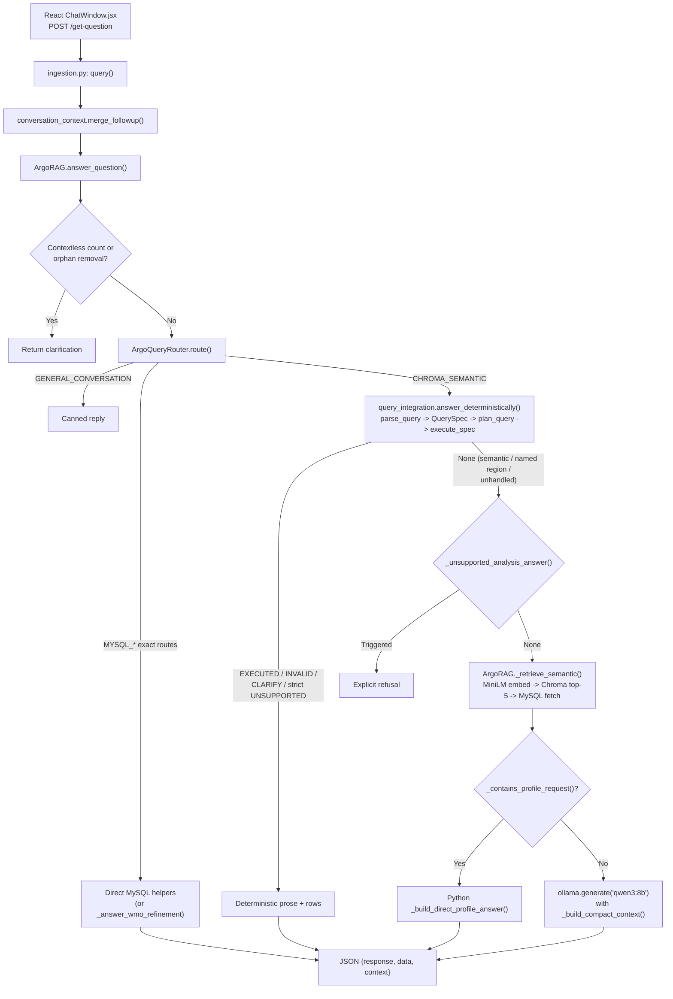
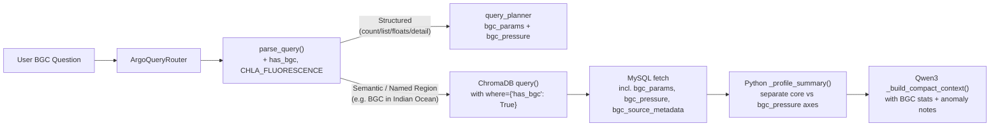

# IntelliQuery — Post-BGC Integration: Query Pipeline Architecture Audit

**Date:** 2026-11-26  
**Scope:** Read-only inspection and architectural audit (no production source files, schemas, database records, or ChromaDB vectors were modified).  
**Current Environment Baseline:** MySQL `argo_ocean_data_fresh` (`2,016` profiles: `1,384` core + `632` BGC; `30` floats) and ChromaDB `backend/chroma_db_storage_fresh` / `argo_float_profiles` (`2,016` synchronized vectors).

---

## 1. Executive Summary

IntelliQuery's production chat query pipeline is a **hybrid deterministic-first, semantic-fallback architecture** served by Flask (`POST /get-question` in `backend/ingestion.py`) and orchestrated by `ArgoRAG.answer_question()` (`backend/llmbackend.py`). Contrary to a pure LLM-RAG design, exact identifiers, float/profile counts, and structured queries are intercepted by `ArgoQueryRouter` and the Phase 4B deterministic `QuerySpec` pipeline (`query_parser.py` → `query_spec.py` → `query_pipeline.py` → `query_planner.py` → `query_integration.py`) **before** any ChromaDB vector search or Qwen3 (`qwen3:8b`) call occurs.

**BGC Readiness Verdict:** **Partially implemented at the parser/planner layer, broken end-to-end.**  
* Five BGC parameters (`DOXY`, `CHLA`, `BBP700`, `NITRATE`, `PH_IN_SITU_TOTAL`) already exist in `QuerySpec` (`Parameter` enum), `query_parser.py`, and `query_planner.py` (`JSON_CONTAINS_PATH` on `bgc_params`/`bgc_adjusted`).  
* However, **critical gaps** prevent reliable BGC querying:
  1. `"BGC"` / `"core-only"` / `CHLA_FLUORESCENCE` are unrecognized by `query_parser.py` and `QuerySpec` (e.g., *"How many BGC profiles are available?"* returns `2,016` instead of `632`).
  2. `ArgoRAG._retrieve_semantic()` performs pure embedding search **without** ChromaDB `where` metadata filtering (`has_bgc`, `product_type`, `bgc_parameters`), causing *"Find BGC profiles in the Indian Ocean"* to return `5` core-only (`has_bgc=False`) profiles.
  3. `ArgoRAG._profile_summary()`, `_build_compact_context()`, `_build_direct_profile_answer()`, `query_integration._render_profile_detail()`, and `query_planner._plan_profile_detail()` **completely ignore `bgc_params`, `bgc_pressure`, `bgc_source_metadata`, and `direction`**—so Qwen3 and direct Python answers never see BGC measurements or independent BGC pressure axes.
  4. Float-level parameter queries (*"Find floats with chlorophyll measurements"*) are mapped to profile-level `parameter_availability` (returning counts of 5 profiles instead of distinct WMO floats).
  5. `explorer_api.py` (Data Explorer) and `Visualization.jsx` (illustrative static chart/globe) have zero BGC awareness.

---

## 2. Actual Existing Architecture

### Verified Production Architecture
1. **Frontend (`frontend/src/`):**
   * **Chat UI:** `ChatWindow.jsx` posts `{ prompt, context }` to `POST ${BASE_URL}/get-question` (`http://localhost:5000/get-question`). Renders `msg.text` via `ReactMarkdown` and `msg.data` as a 5-column metadata table (`profile_id`, `cycle_number`, `profile_time`, `latitude`, `longitude`).
   * **Visualization Panel (`Home.jsx` → `Visualization.jsx`):** Triggered on first chat message (`onFirstMessage`), but displays **static illustrative data** (*"Global Sea Surface Temperature Anomaly (2019-2024) — Illustrative"*) and a 3D globe; it is **not** wired to `/get-question` response data.
   * **Data Explorer (`Pages/DataExplorer.jsx`, `api.js`):** Calls `GET /api/data/overview`, `/floats`, `/floats/<wmo>`, `/profiles`, `/profiles/<id>`, `/map-points`, `/export` (`backend/explorer_api.py`).
   * **Legacy/Unused Frontend:** `backend/app.py` is a standalone Streamlit prototype (`st.chat_input`) calling `ArgoRAG.answer_question()` directly; not used by the React app.
2. **Backend Flask Server (`backend/ingestion.py`):**
   * Instantiates `DatabaseManager()`, `ArgoRAG(db_manager)`, registers `explorer_bp` (`/api/data/*`), `/files`, and `/get-question`.
   * Applies `conversation_context.merge_followup(context, user_query)` before calling `rag_chatbot.answer_question(effective_query)`, and returns `extract_context(effective_query)` for stateless follow-ups.
3. **Query Routing & Execution (`backend/llmbackend.py`):**
   * `ArgoQueryRouter.route(question)` (`query_router.py`) classifies into 7 routes: `GENERAL_CONVERSATION`, `MYSQL_PROFILE_COUNTS`, `MYSQL_WMO_PROFILE_COUNT`, `MYSQL_REGIONAL_TREND`, `MYSQL_FLOAT_ENUMERATION`, `MYSQL_WMO`, `CHROMA_SEMANTIC`.
   * Exact MySQL routes execute dedicated SQL helpers in `ArgoRAG` (with WMO refinements delegated to `_answer_wmo_refinement()`).
   * `CHROMA_SEMANTIC` first tries `_answer_with_query_spec()` (`query_integration.answer_deterministically()`), checks `_unsupported_analysis_answer()` guard, and only falls back to `_retrieve_semantic()` (ChromaDB top-5 + MySQL fetch by `profile_id`) → `_build_direct_profile_answer()` or `ollama.generate(model="qwen3:8b")` when the deterministic pipeline returns `None`.
4. **Unused/Shadow Modules:**
   * `query_interpreter.py` / `query_interpreter_schema.py` / `query_shadow.py` implement a Phase 4A Qwen3-to-QuerySpec structured JSON interpreter for offline evaluation/shadowing; they are **not** called in the live `/get-question` request path.

---

## 3. End-to-End Query Lifecycle Trace

Example question: **`"Show me the temperature and salinity profiles for floats in the Indian Ocean."`**

| Step | Component / File | Function / Class | Input → Output | Status |
|---|---|---|---|---|
| 1. Frontend request | `frontend/src/components/ChatWindow.jsx` | `sendMessage()` | `{ prompt, context }` → `POST /get-question` | Functional |
| 2. Flask endpoint | `backend/ingestion.py` | `query()` | Calls `merge_followup()` → `effective_query` | Functional |
| 3. Router classification | `backend/query_router.py` | `ArgoQueryRouter.route()` | No WMO/count pattern → `Route.CHROMA_SEMANTIC` | Functional |
| 4. Query parsing & QuerySpec | `backend/query_parser.py` | `parse_query()` | Extracts `[TEMP, PSAL]`, detects `"indian ocean"` (named ocean region) → `Intent.CLARIFY`, `ValidationStatus.NEEDS_CLARIFICATION`, `spec=None` | Functional |
| 5. QuerySpec integration | `backend/query_integration.py` | `answer_deterministically()` | Sees `_NAMED_REGION_MARKER` (`"named ocean region"`) in clarification → intentionally returns `None` so ChromaDB handles named regions | Functional |
| 6. SQL planning | `backend/query_planner.py` | `plan_query()` | Skipped (`spec=None` → `run_pipeline` returns before `plan_query`) | Functional |
| 7. Analysis guard | `backend/llmbackend.py` | `_unsupported_analysis_answer()` | No analysis keyword (`compare`, `trend`, etc.) → `None` | Functional |
| 8. ChromaDB retrieval | `backend/llmbackend.py` | `_retrieve_semantic()` | Encodes question via `all-MiniLM-L6-v2` → `chroma_collection.query(n_results=5)` (no `where` filter) → `profile_id_sql` list | Functional |
| 9. MySQL fetch | `backend/llmbackend.py` | `_retrieve_semantic()` | Fetches `profile_id, cycle_number, profile_time, latitude, longitude, pressure, temperature, salinity, bgc_params, wmo_number` for top 5 IDs | Functional (drops `bgc_pressure`, `direction`) |
| 10. Python calculations | `backend/llmbackend.py` | `_profile_summary()`, `_build_compact_context()` | `_contains_profile_request()` is `False` (multi-word `"temperature and salinity profiles"` not in list) → computes `min/max/mean/valid_count` for `pressure`, `temperature`, `salinity` only | Functional (core only) |
| 11. Qwen3 response | `backend/llmbackend.py` | `ollama.generate(model="qwen3:8b")` | Compact context + 19 grounding rules → natural-language summary | Functional (requires Ollama running) |
| 12. API response & UI | `backend/ingestion.py`, `ChatWindow.jsx` | `query()`, `ChatWindow` | Returns `{ response, data, context: null }`; UI renders markdown + 5-row profile table | Functional |

---

## 4. Source-File and Function References

* **Chat & Routing:** `backend/ingestion.py` (`query`), `backend/llmbackend.py` (`ArgoRAG`), `backend/query_router.py` (`ArgoQueryRouter`), `backend/conversation_context.py` (`extract_context`, `merge_followup`).
* **Deterministic Query Pipeline:** `backend/query_parser.py` (`parse_query`), `backend/query_spec.py` (`QuerySpec`, `Parameter`, `Intent`, `validate_spec`), `backend/query_pipeline.py` (`run_pipeline`), `backend/query_planner.py` (`plan_query`, `execute_spec`), `backend/query_integration.py` (`answer_deterministically`, `has_structured_refinement`, `_render`).
* **Offline / Shadow LLM Interpreter (not in live chat route):** `backend/query_interpreter.py`, `backend/query_interpreter_schema.py`, `backend/query_shadow.py`.
* **Storage & Ingestion:** `backend/database_manager.py` (`DatabaseManager`, `_build_profile_metadata`, `_build_profile_document`, `sync_profile_vector`), `backend/data_processor.py`, `backend/bgc_matching.py`.
* **Data Explorer & Frontend:** `backend/explorer_api.py` (`create_explorer_blueprint`), `frontend/src/components/ChatWindow.jsx`, `frontend/src/Pages/DataExplorer.jsx`, `frontend/src/components/Visualization.jsx`.

---

## 5. BGC Schema Compatibility Audit

### V4 Schema & ChromaDB Representation (Verified)
* **MySQL `argo_profiles`:** `bgc_params` (`JSON`, keyed by parameter name e.g. `DOXY`, `CHLA`, `BBP700`, `NITRATE`, `PH_IN_SITU_TOTAL`, `CHLA_FLUORESCENCE`), `bgc_pressure` (`JSON`), `bgc_qc` (`JSON`), `bgc_adjusted` (`JSON`), `bgc_adjusted_qc` (`JSON`), `bgc_adjusted_error` (`JSON`), `bgc_source_metadata` (`JSON`, contains `grid_check`: `'ok'` or `'pres_scale_suspect'`), `direction` (`'A'` or `'D'`).
* **ChromaDB `argo_float_profiles`:** Every vector (`2,016` total) carries `has_bgc` (`bool`), `product_type` (`'core'` or `'core_bgc'`), `bgc_parameters` (sorted comma-separated string), `bgc_parameter_count` (`int`), `direction` (`'A'` or `'D'`), `profile_id_sql`, `float_id_sql` (WMO), `cycle_number`, `date`, `latitude`, `longitude`.

### 8 Compatibility Questions

| # | Question | Verified Finding |
|---|---|---|
| 1 | Can the existing parser recognize BGC parameter names? | **Partial.** Recognizes `DOXY`, `CHLA`, `BBP700`, `NITRATE`, `PH_IN_SITU_TOTAL`. **Missing:** `CHLA_FLUORESCENCE` (present in 316 profiles), generic `"BGC"` / `"bio-geochemical"`, and `"core-only"`. |
| 2 | Can `QuerySpec` represent BGC-specific requests? | **Partial.** `Parameter` enum has 5 BGC parameters, but lacks `CHLA_FLUORESCENCE`, a `has_bgc` / `product_type` (`core` vs `core_bgc`) filter, and `direction` (`A`/`D`). |
| 3 | Can the SQL planner safely query BGC measurements? | **Presence only, not values/axes.** Uses `JSON_CONTAINS_PATH(COALESCE(p.bgc_params, '{}'), 'one', '$.KEY')` for `LIST_PROFILES`, `COUNT_PROFILES`, `PARAMETER_AVAILABILITY`. Cannot filter by BGC value/depth/pressure, does **not** select `bgc_pressure` or `bgc_source_metadata` in `PROFILE_DETAIL`, and lacks `CHLA_FLUORESCENCE` in `_BGC_PARAMETER_KEYS`. |
| 4 | Can the system handle profiles where a parameter is missing? | **Yes in SQL/summary.** `JSON_CONTAINS_PATH` excludes profiles lacking a key; `_valid_numbers()` skips `None`/`NaN` for core params. However, `_render_profile_detail()` and `_profile_summary()` never report which BGC keys are present or missing. |
| 5 | Can the system distinguish core-only from core+BGC profiles? | **No in query pipeline.** ChromaDB metadata has `has_bgc` and `product_type`, and SQL has `bgc_params IS NOT NULL`, but neither `query_parser`, `QuerySpec`, `query_planner`, nor `_retrieve_semantic` exposes or filters on them. |
| 6 | Can ChromaDB retrieve BGC-enabled profiles correctly? | **No for filtered queries.** `_retrieve_semantic()` calls `chroma_collection.query(query_embeddings=..., n_results=5)` with **no `where` filter**. E.g. *"Find BGC profiles in the Indian Ocean"* returned 5 `has_bgc=False` profiles. |
| 7 | Can the calculation layer work with independent BGC pressure arrays? | **No.** `ArgoRAG._profile_summary()` only reads `pressure`, `temperature`, `salinity`. It never reads `bgc_pressure` or `bgc_params`, and does not check `bgc_source_metadata.grid_check` (`pres_scale_suspect`). Core `pressure` and `bgc_pressure` cannot be index-aligned. |
| 8 | Can the response generator accurately describe BGC results? | **No.** `_build_compact_context()` omits `bgc_params` and `bgc_pressure` entirely; `_build_direct_profile_answer()` only handles `temperature`, `salinity`, `pressure`; `_render_profile_detail()` only reports `pressure`, `temperature`, `salinity` level counts. |

---

## 6. Existing Test Results

Executed read-only in `backend/` (no tests modified):

* **Core query pipeline suites** (`test_query_spec`, `test_query_parser`, `test_query_planner`, `test_query_pipeline`, `test_query_integration`, `test_query_router`, `test_query_interpreter`, `test_chat_api_errors`, `test_chat_reliability`, `test_chromadb_bgc_metadata`):  
  **`490` tests run in `0.902s` — `OK` (`skipped=9`).**
* **Reliability & boundary suites** (`test_query_boundary_4b2`, `test_query_reliability_4d`, `test_query_reliability_4e`, `test_query_remediation`):  
  **`96` tests run in `0.446s` — `OK`.**
* **BGC promotion & correction suite** (executed during Stage B):  
  **`14` tests run in `132.582s` — `OK`.**

---

## 7. Representative Query Test Results

Executed read-only against live `argo_ocean_data_fresh` and `chroma_db_storage_fresh` through `ArgoQueryRouter`, `parse_query`, `plan_query`, `answer_deterministically`, and `ArgoRAG._retrieve_semantic` / `_unsupported_analysis_answer` (without calling Ollama):

| # | Question | Observed Route / Result | Assessment |
|---|---|---|---|
| 1 | "How many BGC profiles are available?" | `count_profiles`, `parameters=[]` → `"There are 2016 profiles matching the request."` | **Scientifically unreliable / wrong.** Fails to recognize `"BGC"`, counts all 2,016 profiles instead of 632. |
| 2 | "Show profiles containing dissolved oxygen measurements." | `list_profiles`, `parameters=[DOXY]` → `"Found 5 profiles matching the request..."` (5 rows) | **Partially supported.** Correctly filters `DOXY` in SQL, but returns only core metadata (no DOXY values/`bgc_pressure`). |
| 3 | "Find floats with chlorophyll measurements." | `parameter_availability`, `parameters=[CHLA]` → `"Parameter availability for 5 matching profiles: - CHLA: 5 of 5..."` (`rows=0`) | **Partially supported (wrong granularity).** Returns 5-profile availability check instead of distinct WMO floats. |
| 4 | "Compare temperature and salinity for a selected float." | `compare`, `plan_supported=False`, guard triggered → explicit refusal | **Supported (correctly refused).** Honest limitation message. |
| 5 | "Show nitrate measurements at different depths." | `list_profiles`, `parameters=[NITRATE]` → `"Found 5 profiles matching the request..."` (5 rows) | **Partially supported / misleading.** Drops `"at different depths"` and returns no nitrate values. |
| 6 | "Which floats contain pH measurements?" | `parameter_availability`, `parameters=[PH_IN_SITU_TOTAL]` → `"Parameter availability for 5 matching profiles..."` (`rows=0`) | **Partially supported (wrong granularity).** Same float-vs-profile issue as #3. |
| 7 | "Find profiles that contain both DOXY and CHLA." | `list_profiles`, `parameters=[DOXY, CHLA]` → `"Found 5 profiles matching the request..."` (5 rows) | **Supports metadata listing.** Correctly applies AND filter on `bgc_params`. |
| 8 | "Show core-only profiles." | `semantic_discovery` → ChromaDB top-5 returned 5 `has_bgc=False` profiles | **Fails to interpret as filter.** Unfiltered vector similarity happened to return core rows, not guaranteed. |
| 9 | "Compare BGC parameter availability across floats." | `compare` (`invalid`), guard triggered → explicit refusal | **Fails to interpret `"BGC"`.** Refused as invalid comparison. |
| 10 | "Find BGC profiles in the Indian Ocean." | `clarify` (named region) → fallback to `_retrieve_semantic` → **5 `has_bgc=False` profiles** | **Fails / wrong results.** Unfiltered ChromaDB returned 5 core-only profiles; Qwen3 receives zero BGC data. |

---

## 8. Architectural Gap Analysis

| Component | Current Implementation | BGC Compatibility | Severity | Required Change |
|---|---|---|---|---|
| **Query parser** (`query_parser.py`) | Parses 5 BGC params (`DOXY`, `CHLA`, `BBP700`, `NITRATE`, `PH_IN_SITU_TOTAL`); ignores `"BGC"`, `"core-only"`, `CHLA_FLUORESCENCE`; float-seeking `"Find floats with X"` maps to `PARAMETER_AVAILABILITY` | Partial | **Critical** | Add `CHLA_FLUORESCENCE`, `has_bgc` (`"bgc"` / `"core-only"`), and float-level parameter intent/grouping (`GroupBy.WMO` or float listing) |
| **QuerySpec** (`query_spec.py`) | `Parameter` has 5 BGC params; no `has_bgc` / `product_type` or `direction` field | Partial | **Critical** | Add `CHLA_FLUORESCENCE` to `Parameter`/`BGC_PARAMETERS`; add optional `has_bgc: bool \| None` (or `product_type`) |
| **Query planner** (`query_planner.py`) | Filters `bgc_params` via `JSON_CONTAINS_PATH`; `PROFILE_DETAIL` omits `bgc_pressure`, `bgc_source_metadata`, `direction`; cannot list distinct floats by parameter | Partial | **Critical** | Add `CHLA_FLUORESCENCE` key, `has_bgc` SQL predicate (`bgc_params IS NOT NULL` / `IS NULL`), float-by-parameter template, and select `bgc_pressure`, `bgc_source_metadata`, `direction` in `PROFILE_DETAIL` |
| **SQL execution** (`query_planner.py`, `query_integration.py`) | Parameterized SQLAlchemy; `_render_profile_detail` only inspects `pressure`/`temperature`/`salinity` | Partial | **High** | Update `_render_profile_detail` to summarize `bgc_params` keys, `bgc_pressure` level count, and `pres_scale_suspect` warning |
| **ChromaDB retrieval** (`llmbackend.py`) | `_retrieve_semantic()` queries top-5 embeddings with **no `where` filter** and SQL `SELECT` omits `bgc_pressure`, `bgc_source_metadata`, `direction` | Incompatible | **Critical** | Pass ChromaDB `where` metadata filters (`has_bgc`, `product_type`) when BGC/core-only is requested; select `bgc_pressure`, `bgc_source_metadata`, `direction` from MySQL |
| **Calculations** (`llmbackend.py`) | `_profile_summary()` only summarizes `pressure`, `temperature`, `salinity`; `_requested_variable` / `_contains_profile_request` ignore BGC | Incompatible | **High** | Extend `_profile_summary()` to summarize each `bgc_params` array alongside `bgc_pressure` (never core `pressure`), preserving `NaN`/missing handling and flagging `pres_scale_suspect` |
| **Response generation** (`llmbackend.py`) | `_build_compact_context()` omits BGC entirely; Qwen3 prompt has no BGC/pressure-axis rules | Incompatible | **High** | Include per-parameter BGC valid counts, ranges, and `bgc_pressure` axis/anomaly notes in `_build_compact_context()` |
| **Frontend & Explorer** (`ChatWindow.jsx`, `explorer_api.py`) | `ChatWindow` shows 5 core columns; `explorer_api.py` has no BGC filter/detail fields; `Visualization.jsx` is static | Partial | **Medium** | Optionally add BGC badge/params in `ChatWindow` table and `explorer_api.py` filters in a later phase |

---

## 9. Minimal Recommended Integration Architecture

Preserve the existing hybrid router + deterministic `QuerySpec` + ChromaDB/Qwen3 fallback architecture without introducing a separate BGC engine or duplicating SQL/retrieval code:

1. **Extend existing `QuerySpec` & `query_parser.py`:**
   * Add `CHLA_FLUORESCENCE` to `Parameter` & `BGC_PARAMETERS`.
   * Add optional `has_bgc: bool | None = None` to `QuerySpec` (and parse `"bgc"` / `"bio-geochemical"` → `has_bgc=True`, `"core-only"` → `has_bgc=False`).
   * Route float-level parameter questions (*"Which floats contain pH?"*, *"Find floats with chlorophyll"*) to a deterministic distinct-WMO listing or `GroupBy.WMO` count rather than 5-row profile availability.
2. **Extend `query_planner.py` & `query_integration.py`:**
   * Apply `p.bgc_params IS NOT NULL` / `IS NULL` when `spec.has_bgc` is set.
   * Add `CHLA_FLUORESCENCE` to `_BGC_PARAMETER_KEYS`.
   * Include `p.bgc_pressure`, `p.bgc_source_metadata`, `p.direction` in `_plan_profile_detail()` and surface BGC parameter counts + `pres_scale_suspect` caveats in `_render_profile_detail()`.
3. **Add Metadata-Filtered Semantic Retrieval & BGC Context in `llmbackend.py`:**
   * In `_retrieve_semantic(question)`: derive lightweight metadata filter (`has_bgc=True` for BGC queries, `has_bgc=False` for core-only) and pass `where=...` to `chroma_collection.query()`.
   * Fetch `p.bgc_pressure`, `p.bgc_source_metadata`, `p.direction` in `_retrieve_semantic()`.
   * Extend `_profile_summary()` and `_build_compact_context()` to compute valid counts, min/max/mean on `bgc_params[param]` paired strictly with `bgc_pressure` (never core `pressure`), and emit a data-quality note if `grid_check == 'pres_scale_suspect'`.

---

## 10. Prioritized Implementation Roadmap

1. **Priority 1 (Critical — Correctness):** Extend `query_spec.py`, `query_parser.py`, `query_planner.py` (`has_bgc`, `CHLA_FLUORESCENCE`, distinct floats by parameter) so *"How many BGC profiles?"*, *"Show core-only profiles"*, and *"Which floats contain pH?"* return exact SQL answers.
2. **Priority 2 (Critical — Semantic Retrieval):** Add `where` metadata filtering (`has_bgc`, `product_type`) and `bgc_pressure`/`bgc_source_metadata` SQL selection in `ArgoRAG._retrieve_semantic()`.
3. **Priority 3 (High — Scientific Integrity & Response):** Update `_profile_summary()`, `_build_compact_context()`, `_build_direct_profile_answer()`, and `_render_profile_detail()` to summarize BGC arrays against `bgc_pressure` and surface `pres_scale_suspect` warnings.
4. **Priority 4 (Medium — Explorer & UI):** Expose BGC parameters and `bgc_pressure` in `explorer_api.py` and `ProfileDetailDrawer.jsx` / `ChatWindow.jsx` (deferred until chat pipeline is verified).

---

## 11. Risks and Unresolved Questions

1. **Pressure-axis confusion:** `13` BGC profiles have `pres_scale_suspect` (synthetic `bgc_pressure` ~1000x smaller than core `pressure`); any calculation or prompt that mixes `pressure` with `bgc_params` will produce scientifically invalid depth pairings.
2. **`CHLA_FLUORESCENCE` vs `CHLA`:** `316` profiles carry both `CHLA` and `CHLA_FLUORESCENCE`; user queries saying *"chlorophyll"* should be clearly documented as querying `CHLA` (or both) without conflating units.
3. **Ollama availability:** Live Qwen3 response generation requires a local `ollama` daemon with `qwen3:8b`; during this audit, Ollama was not running, so Qwen3 prompt rendering was verified by code inspection while deterministic SQL and ChromaDB retrieval were verified live.
4. **Named ocean regions:** Named regions (e.g., *"Indian Ocean"*) still rely on ChromaDB semantic search rather than SQL bounding boxes; adding `where={"has_bgc": True}` fixes BGC filtering, but geographic accuracy for named regions remains bounded by ChromaDB top-`k` (`n_results=5`).
